# 🧠 Agent Swarm Kernel (`ask`)
## Systems Architecture & Product Requirements Document

```text
       _   ____ _____ _   _ _____   ______      ___    ____  __  __   _  _______ ____  _   _ _____ _     
      / \ / ___| ____| \ | |_   _| / ___\ \    / / \  |  _ \|  \/  | | |/ / ____|  _ \| \ | | ____| |    
     / _ \ |  _|  _| |  \| | | |   \___ \\ \  / / _ \\ | |_) | |\/| | | ' /|  _| | |_) |  \| |  _| | |    
    / ___ \ |_| | |__| |\  | | |    ___) |\ \/ / ___ \|  _ <| |  | | | . \| |___|  _ <| |\  | |___| |___ 
   /_/   \_\____|_____|_| \_| |_|   |____/  \_/_/   \_\_| \_\_|  |_| |_|\_\_____|_| \_\_| \_|_____|_____|
```

> **High-Throughput User-Space Microkernel & Lock-Free Thread-per-Core Runtime for Autonomous AI Agent Swarms**  
> *Engineered in Rust. Zero-allocation SPSC IPC. OS thread-to-core pinning. Off-core async I/O worker pool.*

---

## 1. Executive Summary & Architecture Principles

**Agent Swarm Kernel (`ask`)** applies thread-per-core systems engineering (Seastar, ScyllaDB, DPDK) to multi-agent coordination and message dispatch:

1. **Thread-per-Core Sharded Reactor:** Shared-nothing `ShardReactor` threads pinned via `sched_setaffinity` on Linux and Mach `thread_policy_set` (`THREAD_AFFINITY_POLICY`) on macOS, eliminating cross-thread mutex contention on agent state.
2. **Zero-Allocation Hot Path:** `MessageEnvelope` (`104 B`, `Copy`) uses a fixed 64-byte stack-allocated `InlinePayload` (`[u8; 64]` + `payload_len: u8`) paired with pre-allocated reusable reactor buffers (`local_inbox`, `processing_buf`, `outgoing_buf`, `reusable_ctx`) and dense O(1) array indexing (`dense_agents`).
3. **Lock-Free Pairwise SPSC Mesh (`rtrb`):** Dedicated directional Single-Producer Single-Consumer ring buffers between every core pair, tracking real `QueueFull` drop counts and live atomic ring fill utilization.
4. **Decoupled Async I/O Worker Pool (`IoWorkerPool`):** Offloads slow or blocking I/O closures submitted via `Context::spawn_io` to background worker threads and delivers completion `MessageEnvelope`s back to the requesting agent's shard inbox without stalling reactor throughput.
5. **Real Latency & Memory Telemetry:** Pure-Rust 256-bucket log2 `LatencyHistogram` (4 sub-buckets per power-of-two) measures monotonic send-to-handle `p50`/`p99`/`max` latencies, while `ask bench` measures process RSS deltas via `libc::getrusage`.

---

## 2. High-Level Architecture

```mermaid
flowchart TD
    subgraph Host["Hardware Architecture - Core Reactors"]
        subgraph Core0["Core 0 Reactor"]
            Exec0["ShardReactor 0<br/>Bounded Tick Gas + Dense Table"]
            Shard0["Agents 0, K, 2K..."]
            Exec0 --> Shard0
        end

        subgraph Core1["Core 1 Reactor"]
            Exec1["ShardReactor 1<br/>Bounded Tick Gas + Dense Table"]
            Shard1["Agents 1, K+1, 2K+1..."]
            Exec1 --> Shard1
        end

        subgraph CoreN["Core N Reactor"]
            ExecN["ShardReactor N<br/>Bounded Tick Gas + Dense Table"]
            ShardN["Remaining Agents"]
            ExecN --> ShardN
        end
    end

    subgraph IPCMesh["Lock-Free IPC Mesh - Pairwise rtrb SPSC Rings"]
        Ring01["SPSC Ring 0 -> 1"]
        Ring10["SPSC Ring 1 -> 0"]
        Ring0N["SPSC Ring 0 -> N"]
        RingN0["SPSC Ring N -> 0"]
    end

    subgraph AsyncIO["Off-Core Async I/O Pool"]
        Pool["IoWorkerPool<br/>Non-Blocking try_send + Per-Shard Completion Rx"]
    end

    Core0 <-->|"Zero-Alloc 104B Envelopes"| Ring01
    Core1 <-->|"Zero-Alloc 104B Envelopes"| Ring10
    Core0 <-->|"Zero-Alloc 104B Envelopes"| Ring0N
    CoreN <-->|"Zero-Alloc 104B Envelopes"| RingN0

    Exec0 -.->|"Context::spawn_io"| Pool
    Exec1 -.->|"Context::spawn_io"| Pool
    ExecN -.->|"Context::spawn_io"| Pool
```



---

## 3. Core Subsystems & Crate Hierarchy

```text
agent-swarm-kernel/
├── Cargo.toml                      # Workspace Root
├── crates/
│   ├── ask-core/                   # Agent trait, AgentId, InlinePayload/MessageEnvelope, LatencyHistogram, Context
│   ├── ask-ipc/                    # Lock-free pairwise rtrb SPSC rings, drop counters, utilization bps
│   ├── ask-scheduler/              # OS affinity pinning, IoWorkerPool, ShardReactor, Kernel & live telemetry
│   └── ask-cli/                    # 'ask' CLI: bench (RSS/latency), run (ring/mesh/gossip), live monitor
```

### 3.1 `ask-core`
- **`AgentId`**: 64-bit compact identifier encoding 16-bit shard index and 48-bit local agent sequence.
- **`AgentState`**: Minimal state machine: `Dormant`, `Active`, `Yielded`, `Terminated`.
- **`MessageEnvelope`**: `Copy`, `104 B` envelope with 64-byte `InlinePayload` (`[u8; 64]` + `payload_len: u8`) and monotonic nanosecond timestamp (`monotonic_now_ns()`).
- **`LatencyHistogram`**: Pure-Rust 256-bucket log2 histogram (`4` sub-buckets per power-of-two) supporting O(1) recording, merging across shards, and interpolated `percentile_ns(q)` queries.
- **`Context` & `Agent` Trait**:
  ```rust
  pub trait Agent: Send + 'static {
      fn id(&self) -> AgentId;
      fn state(&self) -> AgentState;
      fn handle_message(&mut self, env: MessageEnvelope, ctx: &mut Context) -> ExecutionResult;
      fn tick(&mut self, ctx: &mut Context) -> ExecutionResult;
  }
  ```
  `Context` exposes `send(env)` for zero-alloc SPSC messaging and `spawn_io(requester, correlation_id, kind, closure)` for off-core asynchronous I/O.

### 3.2 `ask-ipc`
- **Pairwise SPSC Ring Buffers (`rtrb`)**: Directed lock-free SPSC rings between every pair of core shards (`O(1)` vector lookup by target core).
- **Backpressure & Utilization Telemetry**: Tracks `QueueFull` / invalid-target drops (`dropped_count()`) and instantaneous atomic ring utilization in basis points (`ring_utilization_bps()`).

### 3.3 `ask-scheduler`
- **OS Thread-to-Core Pinning (`affinity.rs`)**: Calls `sched_setaffinity` (Linux, respecting `sched_getaffinity` allowed masks) and Mach `thread_policy_set` (`THREAD_AFFINITY_POLICY`, macOS), accurately reporting how many reactor threads were pinned by the host kernel.
- **Off-Core `IoWorkerPool` (`io_pool.rs`)**: Bounded non-blocking submission queue (`try_send`) feeding dedicated `ask-io-worker-*` threads that route completion envelopes back to the requester's shard completion channel.
- **`ShardReactor`**: Dense O(1) agent table (`dense_agents` + `sparse_agents` fallback), zero-allocation buffer swapping (`local_inbox` / `processing_buf` / `outgoing_buf`), bounded cooperative round-robin tick gas (`256` agents/step), and periodic atomic publication to `SharedShardTelemetry`.
- **`Kernel` & `KernelHandle`**: Provides `snapshot()` for live non-blocking telemetry sampling, `pinned_cores()`, `stop()`, and `shutdown()`.

### 3.4 `ask-cli` (`ask`)
- **`ask bench`**: Spawns `N` agents across `K` cores, measures `std::mem::size_of` and `libc::getrusage` (`ru_maxrss`) deltas, runs live cross-core traffic, and prints measured throughput, `QueueFull` drops, and `p50`/`p99`/`max` latencies.
- **`ask run --topology <ring|mesh|gossip>`**: Executes distinct routing implementations (`RelayAgent` ring, `MeshAgent` 8-neighbor cross-core pool, `GossipAgent` bounded-fanout + TTL epidemic waves via `xorshift64`), reporting delivery rates, drops, throughput, and latency quantiles.
- **`ask monitor`**: Boots a live `Kernel`, samples atomic `ShardSnapshot` telemetry every `250ms`, and renders per-core `Ops/s`, `Ticks/s`, `Ring %`, `Drops`, and `p50`/`p99` latencies with clean TTY ANSI refresh, `--seconds`, non-TTY bounded exit, and `SIGINT` handling.

---

## 4. Measured Performance Baseline

Measured on Apple Silicon (macOS, 4 core reactors, release build):

| Workload | Agents | Measured Throughput | Delivery Rate | Transit Latency (p50 / p99) |
| :--- | :---: | :---: | :---: | :---: |
| **`ask bench` (Ring Relay)** | 100,000 | **22.32M ops/sec** | 100.00% (0 drops) | 20.71 µs / 55.56 µs |
| **`ask run --topology ring`** | 10,000 | **18.79M ops/sec** | 100.00% (0 drops) | 3.07 µs / 6.97 µs |
| **`ask run --topology mesh`** | 10,000 | **23.28M ops/sec** | 100.00% (0 drops) | 5.21 µs / 11.64 µs |
| **`ask run --topology gossip`** | 10,000 | **12.78M ops/sec** | 100.00% (0 drops) | 197.89 µs / 457.11 µs |

- **Struct Footprints:** `RelayAgent` = `24 B`, `MessageEnvelope` = `104 B`
- **Measured Process RSS Delta (100,000 agents):** `+7.17 MB` (`~75.2 B/agent`, Peak RSS `9.73 MB`)

---

## 5. Roadmap & Deliverables

1. **Phase 1: Core Kernel & SPSC Mesh** — `ask-core`, `ask-ipc`, `ask-scheduler`, and `ask-cli` workspace crates.
2. **Phase 2: Affinity, Zero-Alloc Hot Path, Async I/O & Telemetry** — OS core pinning, `104 B` inline envelopes, `IoWorkerPool`, 256-bucket `LatencyHistogram`, multi-topology `ask run`, `getrusage` RSS measurement, and live 250ms `ask monitor`.
3. **Phase 3: Cold Storage & Adaptive Backpressure** — NVMe/RocksDB agent state pagination, dynamic actor DAG supervision trees, and credit-based ring throttling.
