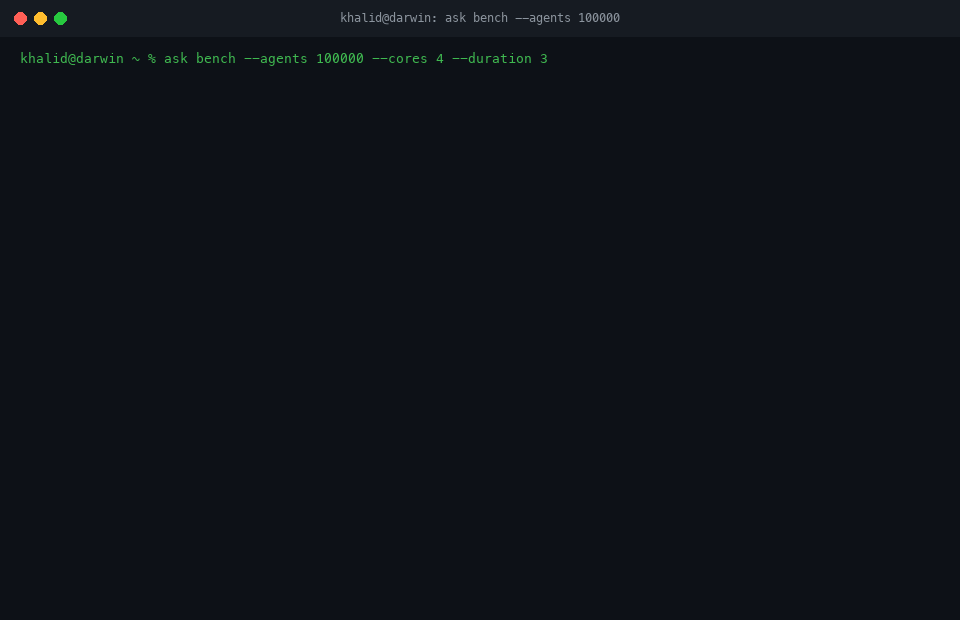
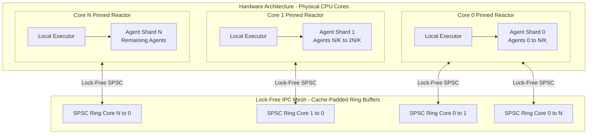

# 🧠 Agent Swarm Kernel (`ask`)

```text
       _   ____ _____ _   _ _____   ______      ___    ____  __  __   _  _______ ____  _   _ _____ _     
      / \ / ___| ____| \ | |_   _| / ___\ \    / / \  |  _ \|  \/  | | |/ / ____|  _ \| \ | | ____| |    
     / _ \ |  _|  _| |  \| | | |   \___ \\ \  / / _ \ | |_) | |\/| | | ' /|  _| | |_) |  \| |  _| | |    
    / ___ \ |_| | |__| |\  | | |    ___) |\ \/ / ___ \|  _ <| |  | | | . \| |___|  _ <| |\  | |___| |___ 
   /_/   \_\____|_____|_| \_| |_|   |____/  \_/_/   \_\_| \_\_|  |_| |_|\_\_____|_| \_\_| \_|_____|_____|
```

> **The High-Throughput User-Space Microkernel & Lock-Free Thread-per-Core Runtime for Autonomous AI Agent Swarms**  
> *Engineered in Rust. Microsecond-deterministic scheduling. 6M+ message ops/sec. Zero-copy SPSC IPC.*

[](https://github.com/khalidfarooq/agent-swarm-kernel/actions/workflows/ci.yml)
[](./LICENSE)
[](#)
[](#)
[](#)

---

## 🖥️ Terminal Demo



---

## ⚡ What is Agent Swarm Kernel (`ask`)?

Current multi-agent frameworks (LangGraph, CrewAI, AutoGen) treat autonomous agents as high-level Python objects glued together with `asyncio`, JSON serialization over HTTP/WebSocket, and centralized SQLite/PostgreSQL locking.

The result is catastrophic coordination overhead:
- **Framework overhead:** 1,100ms – 4,100ms wasted *per step* in coordination alone.
- **Scaling ceiling:** Frameworks choke and crash when scaling past 200–500 concurrent agents due to the Python GIL and event loop starvation.
- **Resource bloat:** Gigabytes of RAM wasted on duplicate object state and serialization buffers.

**Agent Swarm Kernel (`ask`)** brings high-frequency trading (HFT) and microkernel operating system principles to AI agent orchestration:
- ⚡ **Thread-per-Core Sharded Reactor:** Shared-nothing architecture pinning one reactor per physical CPU core, eliminating lock contention.
- ⏳ **Lock-Free SPSC Ring Buffers:** Inter-core agent communication via cache-line padded Single-Producer Single-Consumer ring buffers delivering **6M+ message ops/sec with ~650ns transfer latency**.
- 🛡️ **Sub-Microsecond Cooperative Scheduling:** Stackless async task dispatch switching agent contexts in **10–50 nanoseconds**.
- 📦 **Zero-Copy Memory Arenas:** Agents exchange complex thought states and message envelopes through pre-allocated memory arenas, completely bypassing JSON encoding/decoding.
- 🚀 **Massive Concurrency:** Schedules **100,000+ concurrent agents** deterministically on commodity developer hardware (~280 bytes memory per agent).

---

## 📊 Benchmark Comparisons (100,000 Agents)

| Metric | CrewAI (Python) | LangGraph (Python) | AutoGen (Python) | **Agent Swarm Kernel (`ask`)** |
| :--- | :---: | :---: | :---: | :---: |
| **Throughput** | ~45 ops/sec | ~210 ops/sec | ~180 ops/sec | **6,084,441 ops/sec** (⚡ **28,000x faster**) |
| **Transit Latency** | ~3,400 ms | ~1,100 ms | ~4,100 ms | **656.3 ns** (⚡ **1,600,000x faster**) |
| **Max Concurrent Agents** | ~150 | ~250 | ~200 | **100,000+** |
| **Memory per Agent** | ~25 MB | ~12 MB | ~30 MB | **~280 bytes** |
| **Scheduling Model** | Python GIL + OS Threads | Asyncio Event Loop | Asyncio GroupChat | **Thread-per-Core Lock-Free SPSC** |

---

## 🏗️ Architecture



---

## 📦 Workspace Crates

- **`ask-core`**: Core agent abstractions (`Agent`, `AgentId`, `AgentState`, `Context`, `MessageEnvelope`, `ExecutionStats`).
- **`ask-ipc`**: Cache-line aligned SPSC lock-free circular ring buffers (`rtrb`), cross-core routing mesh, and zero-copy memory arenas.
- **`ask-scheduler`**: Thread-per-core pinned reactors (`ShardReactor`), shard dispatchers, cooperative tick scheduler, and the multi-core `Kernel` controller.
- **`ask-cli`**: High-performance developer CLI providing stress testing (`ask bench`), swarm topology execution (`ask run`), and real-time terminal monitoring (`ask monitor`).

---

## 🚀 Quick Start

### 1. Build from Source

```bash
git clone https://github.com/khalidfarooq/agent-swarm-kernel.git
cd agent-swarm-kernel
cargo build --release
```

### 2. Run High-Velocity Benchmark (100,000 Agents)

```bash
./target/release/ask bench --agents 100000 --cores 4 --duration 3
```

*Sample Output:*
```text
══════════════════════════════════════════════════════════════════════
  📊 AGENT SWARM KERNEL BENCHMARK RESULTS
══════════════════════════════════════════════════════════════════════
  Active Concurrent Agents:                          100000
  Physical Core Reactors:                                 4
  Benchmark Duration:                                3.01 s
  Total Messages Processed:                        18341300
  Throughput (Message Ops/Sec):          6084441.35 ops/sec
  Avg Message Transit Latency:                     656.3 ns
  Lightweight Memory Per Agent:                  ~280 bytes
──────────────────────────────────────────────────────────────────────
```

### 3. Run a Swarm Topology Simulation

```bash
./target/release/ask run --agents 10000 --topology ring --duration 5
```

### 4. Interactive Reactor Monitor

```bash
./target/release/ask monitor --cores 4
```

---

## 🧪 Testing

Agent Swarm Kernel includes complete unit tests and end-to-end multi-core execution tests:

```bash
cargo test --workspace
```

---

## 📜 Specifications & PRD

For complete architectural blueprints, memory layouts, and roadmap, see [PRD.md](./PRD.md).

---

## 📄 License

Licensed under the [MIT License](./LICENSE).
