# 🧠 Agent Swarm Kernel (`ask`)

```text
       _   ____ _____ _   _ _____   ______      ___    ____  __  __   _  _______ ____  _   _ _____ _     
      / \ / ___| ____| \ | |_   _| / ___\ \    / / \  |  _ \|  \/  | | |/ / ____|  _ \| \ | | ____| |    
     / _ \ |  _|  _| |  \| | | |   \___ \\ \  / / _ \ | |_) | |\/| | | ' /|  _| | |_) |  \| |  _| | |    
    / ___ \ |_| | |__| |\  | | |    ___) |\ \/ / ___ \|  _ <| |  | | | . \| |___|  _ <| |\  | |___| |___ 
   /_/   \_\____|_____|_| \_| |_|   |____/  \_/_/   \_\_| \_\_|  |_| |_|\_\_____|_| \_\_| \_|_____|_____|
```

> **High-Throughput User-Space Scheduling & Lock-Free IPC Substrate for AI Agent Swarms**  
> *Engineered in Rust. Thread-per-core reactors. Zero-allocation SPSC message passing. Off-core async I/O worker pool.*

[](https://github.com/khalidfarooq/agent-swarm-kernel/actions/workflows/ci.yml)
[](./LICENSE)
[](#)

---

## 🖥️ Terminal Benchmark Demo


---

## 🔍 What is Agent Swarm Kernel (`ask`)?

**Agent Swarm Kernel (`ask`)** is a systems runtime exploring how techniques from high-frequency trading (HFT) and thread-per-core operating systems (e.g., Seastar, ScyllaDB, DPDK) apply to the **coordination and scheduling layer** of massive multi-agent systems.

### What it IS:
- A **user-space scheduling runtime** written in Rust with OS thread-to-core affinity pinning (`sched_setaffinity` on Linux, Mach `thread_policy_set` `THREAD_AFFINITY_POLICY` on macOS).
- A **lock-free message router** using pairwise `rtrb` Single-Producer Single-Consumer (SPSC) ring buffers and `Copy` 64-byte inline `MessageEnvelope` structs (`104 B`) for zero heap allocations on the hot path.
- A **hybrid reactor + off-core I/O runtime** combining pinned `ShardReactor` loops with an `IoWorkerPool` so slow external I/O tasks never stall local shard message throughput.
- An **instrumented telemetry kernel** tracking real `QueueFull` backpressure drops, live ring utilization, `ru_maxrss` memory deltas, and a pure-Rust 256-bucket log2 `LatencyHistogram` for `p50`/`p99`/`max` transit latencies.

### What it IS NOT:
- **It is NOT an LLM inference engine.** It does not generate tokens, host neural network weights, or accelerate remote model API calls.
- **It is NOT a full-stack application framework.** It focuses purely on deterministic scheduling, IPC routing, and telemetry rather than prompt templates or vector databases.

---

## 📊 Measured Benchmarks & Telemetry

Running `./target/release/ask bench --agents 100000 --cores 4 --duration 3` on Apple Silicon (macOS, 4 core reactors) yields:

```text
══════════════════════════════════════════════════════════════════════
  AGENT SWARM KERNEL BENCHMARK TELEMETRY
══════════════════════════════════════════════════════════════════════
  Active Concurrent Agents:                                    100000
  Core Reactors (OS-Pinned):                             4 (0 pinned)
  Benchmark Duration:                                          3.02 s
  Total Messages Delivered:                                  67303091
  SPSC QueueFull Drops:                                             0
  Measured Throughput:                            22316361.26 ops/sec
  Transit Latency (p50 / p99 / max):    20.71 µs / 55.56 µs / 3.83 ms
  Struct Size (Agent / Envelope):                        24 B / 104 B
  Measured RSS Delta (Peak RSS):     +7.17 MB (~75.2 B/agent) [Peak 9.73 MB]
══════════════════════════════════════════════════════════════════════
```

*(Note: On Apple Silicon, the macOS kernel returns `KERN_NOT_SUPPORTED` for Mach `THREAD_AFFINITY_POLICY`, so `Core Reactors (OS-Pinned)` reports `0 pinned` accurately. On Linux x86_64/ARM64, `sched_setaffinity` pins each reactor thread to its target logical CPU.)*

### Multi-Topology Throughput (`10,000` Agents, `4` Cores, `2s`)

| Topology | Routing Strategy | Measured Throughput | Delivery Rate | Transit p50 / p99 |
| :--- | :--- | :---: | :---: | :---: |
| **`ring`** | Deterministic `i -> (i + 1) % N` | **18.79M ops/sec** | 100.00% | 3.07 µs / 6.97 µs |
| **`mesh`** | 8-peer cross-core pool + `xorshift64` | **23.28M ops/sec** | 100.00% | 5.21 µs / 11.64 µs |
| **`gossip`** | Bounded fanout (`k=3`) + `TTL=10` waves | **12.78M ops/sec** | 100.00% | 197.89 µs / 457.11 µs |

---

## 🏗️ Architecture

```mermaid
flowchart TD
    subgraph Host["Hardware Architecture - Core Reactors"]
        subgraph Core0["Core 0 Reactor"]
            Exec0["ShardReactor 0<br/>Bounded Tick Gas + Dense Table"]
            Shard0["Agents 0, K, 2K..."]
            Exec0 --> Shard0
        end

        subgraph Core1["Core 1 Reactor"]
            Exec1["ShardReactor 1<br/>Bounded Tick Gas + Dense Table"]
            Shard1["Agents 1, K+1, 2K+1..."]
            Exec1 --> Shard1
        end

        subgraph CoreN["Core N Reactor"]
            ExecN["ShardReactor N<br/>Bounded Tick Gas + Dense Table"]
            ShardN["Remaining Agents"]
            ExecN --> ShardN
        end
    end

    subgraph IPCMesh["Lock-Free IPC Mesh - Pairwise rtrb SPSC Rings"]
        Ring01["SPSC Ring 0 -> 1"]
        Ring10["SPSC Ring 1 -> 0"]
        Ring0N["SPSC Ring 0 -> N"]
        RingN0["SPSC Ring N -> 0"]
    end

    subgraph AsyncIO["Off-Core Async I/O Pool"]
        Pool["IoWorkerPool<br/>Non-Blocking try_send + Completion Channels"]
    end

    Core0 <-->|"Zero-Alloc 104B Envelopes"| Ring01
    Core1 <-->|"Zero-Alloc 104B Envelopes"| Ring10
    Core0 <-->|"Zero-Alloc 104B Envelopes"| Ring0N
    CoreN <-->|"Zero-Alloc 104B Envelopes"| RingN0

    Exec0 -.->|"spawn_io / completion"| Pool
    Exec1 -.->|"spawn_io / completion"| Pool
    ExecN -.->|"spawn_io / completion"| Pool
```



---

## 📦 Workspace Crates

- **`ask-core`**: Core abstractions (`Agent`, `AgentId` with bitpacked shard IDs, `AgentState`, `Context` with `spawn_io`, zero-allocation `InlinePayload` / `MessageEnvelope`, `LatencyHistogram`, `ExecutionStats`).
- **`ask-ipc`**: Pairwise lock-free SPSC circular ring buffers (`rtrb`), cross-core `MeshNetwork`, `QueueFull` drop tracking, and live ring utilization telemetry.
- **`ask-scheduler`**: OS thread-to-core affinity pinning (`affinity`), decoupled off-core `IoWorkerPool` (`io_pool`), dense O(1) sharded `ShardReactor` with reusable hot-path buffers and bounded round-robin tick gas, and `Kernel` / `KernelHandle` live snapshot telemetry.
- **`ask-cli`**: Developer CLI providing stress benchmarking (`ask bench`), multi-topology execution (`ask run`), and live 250ms kernel telemetry monitoring (`ask monitor`).

---

## 🚧 Implemented Capabilities & Roadmap

### ✅ Implemented
- [x] **Thread-per-Core Reactors & OS Pinning:** `sched_setaffinity` (Linux) and Mach `thread_policy_set` (macOS) with accurate pinned-core reporting.
- [x] **Zero-Allocation Hot Path:** `Copy` 64-byte inline payload envelopes (`104 B`), dense `Vec` agent indexing, and pre-allocated reusable reactor buffers.
- [x] **Lock-Free SPSC Mesh & Backpressure Counters:** Pairwise `rtrb` rings with `QueueFull` drop counters and atomic ring utilization basis-point sampling.
- [x] **Real Latency Histogram:** Pure-Rust 256-bucket log2 histogram tracking actual monotonic send-to-handle `p50`, `p99`, and `max` latencies.
- [x] **Async I/O Worker Pool:** Decoupled `IoWorkerPool` executing blocking/external tasks off-core and returning completion `MessageEnvelope`s asynchronously to the requester's shard.
- [x] **Live CLI & Topologies:** `ask bench` (with `getrusage` RSS delta), `ask run --topology <ring|mesh|gossip>`, and `ask monitor` (250ms live sampling, TTY ANSI refresh & `--seconds`/Ctrl+C exit).

### ⏳ Next Milestones
- [ ] **State Pagination & Cold Storage:** Storing full agent contexts and conversation histories in NVMe/RocksDB with lazy on-demand paging.
- [ ] **Dynamic Topology & Supervision Trees:** Actor-addressed DAGs with dynamic agent spawning and supervision restarts.
- [ ] **Credit-Based Backpressure:** Adaptive producer throttling when downstream consumer SPSC rings cross high-water thresholds.

---

## 🚀 Quick Start

### 1. Build from Source

```bash
git clone https://github.com/khalidfarooq/agent-swarm-kernel.git
cd agent-swarm-kernel
cargo build --release
```

### 2. Run In-Memory Benchmark (100,000 Agents)

```bash
./target/release/ask bench --agents 100000 --cores 4 --duration 3
```

### 3. Run a Swarm Topology Simulation (`ring`, `mesh`, or `gossip`)

```bash
./target/release/ask run --agents 10000 --topology gossip --duration 5
```

### 4. Live Kernel Telemetry Monitor

```bash
./target/release/ask monitor --cores 4 --seconds 5
```

---

## 🧪 Testing

```bash
cargo test --workspace
```

---

## 📜 Specifications & PRD

For complete architectural blueprints and subsystem details, see [PRD.md](./PRD.md).

---

## 📄 License

Licensed under the [MIT License](./LICENSE).
