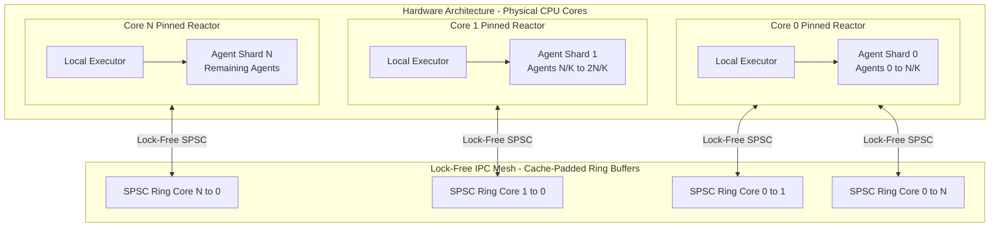

# 🧠 Agent Swarm Kernel (`ask`)

```text
       _   ____ _____ _   _ _____   ______      ___    ____  __  __   _  _______ ____  _   _ _____ _     
      / \ / ___| ____| \ | |_   _| / ___\ \    / / \  |  _ \|  \/  | | |/ / ____|  _ \| \ | | ____| |    
     / _ \ |  _|  _| |  \| | | |   \___ \\ \  / / _ \ | |_) | |\/| | | ' /|  _| | |_) |  \| |  _| | |    
    / ___ \ |_| | |__| |\  | | |    ___) |\ \/ / ___ \|  _ <| |  | | | . \| |___|  _ <| |\  | |___| |___ 
   /_/   \_\____|_____|_| \_| |_|   |____/  \_/_/   \_\_| \_\_|  |_| |_|\_\_____|_| \_\_| \_|_____|_____|
```

> **An Experimental High-Throughput User-Space Scheduling & Lock-Free IPC Substrate for AI Agent Swarms**  
> *Engineered in Rust. Thread-per-core architecture. Zero-lock SPSC message passing. Early-stage systems prototype.*

[](https://github.com/khalidfarooq/agent-swarm-kernel/actions/workflows/ci.yml)
[](./LICENSE)
[](#)
[](#)

---

## 🖥️ Terminal Benchmark Demo


---

## 🔍 What is Agent Swarm Kernel (`ask`)?

**Agent Swarm Kernel (`ask`)** is an experimental systems project exploring how techniques from high-frequency trading (HFT) and thread-per-core operating systems (e.g., Seastar, ScyllaDB, DPDK) can be applied to the **coordination and scheduling layer** of massive multi-agent systems.

### What it IS:
- A **user-space scheduling runtime** written in Rust that pins execution reactors to physical CPU cores.
- A **lock-free message router** using cache-line padded Single-Producer Single-Consumer (SPSC) ring buffers to pass messages across cores without mutex contention.
- An architectural exploration into how low the coordination overhead of multi-agent state machines can go on modern multi-core hardware.

### What it IS NOT:
- **It is NOT an LLM inference engine.** It does not generate tokens, host neural network weights, or magically make cloud API calls (OpenAI, Anthropic) faster.
- **It is NOT a drop-in replacement for full-stack application frameworks yet.** It does not currently manage complex prompt templates, web search integrations, or vector database embeddings out of the box.

---

## 📊 Benchmarks: An Honest Technical Breakdown

The benchmark command (`ask bench --agents 100000 --cores 4`) measures **pure coordination and IPC transit throughput**: how fast the scheduler can dispatch in-memory agent state machines and push message envelopes across physical CPU cores.

```text
══════════════════════════════════════════════════════════════════════
  📊 AGENT SWARM KERNEL BENCHMARK RESULTS (Synthetic In-Memory Relay)
══════════════════════════════════════════════════════════════════════
  Active Concurrent Agents:                          100,000
  Physical Core Reactors:                                  4
  Benchmark Duration:                                 3.01 s
  Total Messages Processed:                         18,341,300
  IPC Throughput:                         6,084,441.35 ops/sec
  Avg Message Transit Latency:                      656.3 ns
  Memory per Agent Struct:                        ~280 bytes
══════════════════════════════════════════════════════════════════════
```

### The Apples-to-Oranges Reality:
- **Why Python frameworks (LangGraph, CrewAI) measure lower ops/sec:** In existing Python frameworks, an "agent step" typically incurs JSON serialization, SQLite/PostgreSQL checkpoint locking, Python GIL contention, and asyncio task overhead.
- **Why ASK measures 6M+ ops/sec:** In this microbenchmark, lightweight agent structs (`RelayAgent`) simply increment an atomic counter and push a byte payload into a dedicated SPSC ring buffer in L1/L2 cache. 
- **The Takeaway:** The benchmark proves that **the coordination layer does not have to be the bottleneck**. By eliminating locks, the GIL, and dynamic allocations on the hot path, scheduling overhead drops from milliseconds to nanoseconds.

---

## 🏗️ Architecture



---

## 📦 Workspace Crates

- **`ask-core`**: Core abstractions (`Agent`, `AgentId` with bitpacked shard IDs, `AgentState`, `Context`, `MessageEnvelope`, `ExecutionStats`).
- **`ask-ipc`**: Pairwise SPSC lock-free circular ring buffers (`rtrb`), cross-core routing mesh, and shared memory abstractions.
- **`ask-scheduler`**: Thread-per-core pinned reactors (`ShardReactor`), shard dispatchers, cooperative tick scheduler, and the multi-core `Kernel` controller.
- **`ask-cli`**: Developer CLI providing stress testing (`ask bench`), swarm topology execution (`ask run`), and real-time terminal monitoring (`ask monitor`).

---

## 🚧 Current Status & Technical Roadmap

This repository is currently a **Phase 0 architectural foundation**. Here is the transparent breakdown of what exists today and what is being built next:

### ✅ Implemented Today
- [x] Thread-per-core sharded reactor architecture (`ShardReactor`).
- [x] Lock-free pairwise SPSC circular ring buffers with zero mutexes.
- [x] In-memory agent state machine (`AgentId`, lifecycle hooks, cooperative dispatch).
- [x] Synthetic multi-core stress benchmark harness scaling to 100,000 in-memory agents.
- [x] Cross-platform build & test suite (macOS and Linux CI).

### ⏳ Work in Progress / Next Milestones
- [ ] **Async I/O Worker Pool:** Offloading long-running external I/O (LLM API requests, tool execution) to non-reactor threads so core reactors never stall.
- [ ] **State Pagination & Cold Storage:** Storing full agent contexts and conversation histories in NVMe/RocksDB with lazy on-demand paging, rather than holding raw contexts in RAM.
- [ ] **Dynamic Topology & Graph Routing:** Moving beyond static ring/mesh topologies to dynamic actor-addressed DAGs with supervision trees.
- [ ] **Credit-Based Backpressure:** Throttling fast upstream producers when downstream consumer ring buffers approach saturation.

---

## 🚀 Quick Start

### 1. Build from Source

```bash
git clone https://github.com/khalidfarooq/agent-swarm-kernel.git
cd agent-swarm-kernel
cargo build --release
```

### 2. Run In-Memory Benchmark (100,000 Agents)

```bash
./target/release/ask bench --agents 100000 --cores 4 --duration 3
```

### 3. Run a Swarm Topology Simulation

```bash
./target/release/ask run --agents 10000 --topology ring --duration 5
```

### 4. Interactive Reactor Monitor

```bash
./target/release/ask monitor --cores 4
```

---

## 🧪 Testing

```bash
cargo test --workspace
```

---

## 📜 Specifications & PRD

For complete architectural blueprints, memory layouts, and roadmap, see [PRD.md](./PRD.md).

---

## 📄 License

Licensed under the [MIT License](./LICENSE).
